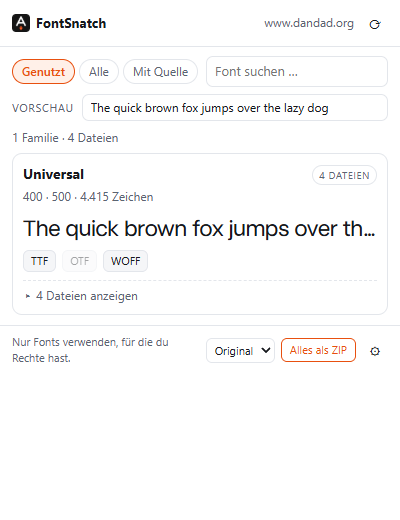

# FontSnatch

Chrome-/Firefox-Extension, die alle Fonts der aktuellen Seite auflistet, sie in
der echten Schrift zeigt und als **TTF**, **OTF** oder **WOFF** herunterlädt.



## Funktionen

- Erkennt genutzte Fonts über die berechneten Styles und ordnet sie den
  `@font-face`-Regeln der Seite zu – auch bei fremden Stylesheets und
  `@import`-Ketten.
- Filter **Genutzt / Alle / Mit Quelle**, Suche und editierbarer Vorschautext.
- Live-Vorschau jedes Fonts im Popup.
- Download pro Datei oder als ZIP (Originalformat oder alles als WOFF).
- Ehrliche Formate: TrueType-Fonts werden als TTF gespeichert, CFF-Fonts als
  OTF. Eine „falsche“ Endung lässt sich in den Einstellungen bewusst erlauben.
- System-Fonts werden grau gelistet, sind aber nicht herunterladbar.
- Fehlende Dateien (z. B. 404 im CSS) werden pro Zeile gemeldet, mit Retry.

## Installation

### Chrome

1. `node scripts/build.mjs` ausführen.
2. `chrome://extensions` öffnen, Entwicklermodus einschalten.
3. „Entpackte Extension laden“ → `dist/chrome` wählen.

### Firefox

1. `node scripts/build.mjs` ausführen.
2. `about:debugging#/runtime/this-firefox` öffnen.
3. „Temporäre Erweiterung laden“ → `dist/firefox/manifest.json` wählen.

## Benutzung

1. Website öffnen, auf das FontSnatch-Icon klicken.
2. Font auswählen, Vorschau prüfen, Format-Button drücken.
3. „Alles als ZIP“ öffnet einen Export-Tab; dort werden alle ladbaren Fonts
   gesammelt und als Archiv gespeichert.

## Formate

| Eingang | Ausgabe |
| --- | --- |
| WOFF2, WOFF, TTF, OTF | TTF (TrueType-Outlines) |
| WOFF2, WOFF, TTF, OTF | OTF (CFF-Outlines) |
| WOFF2, WOFF, TTF, OTF | WOFF |

WOFF/WOFF2 werden entpackt, die Outline-Form bleibt erhalten. Eine echte
Konvertierung zwischen TrueType- und CFF-Outlines ist nicht möglich; der
passende Button ist dann deaktiviert und erklärt warum.

## Grenzen

- EOT, SVG-Fonts und Font-Collections (`.ttc`) werden nicht unterstützt.
- Subset-Fonts bleiben Subsets: Google Fonts liefert pro `unicode-range` nur die
  enthaltenen Glyphen. Die Datei-Zeile zeigt das Subset.
- Variable Fonts werden als eine Datei behandelt.
- System-Fonts lassen sich nicht herunterladen.
- Der Download ersetzt keine Lizenz. Nur Fonts verwenden, für die Rechte
  bestehen.

## Berechtigungen

- `activeTab` + `scripting`: Analyse der aktuellen Seite nach Klick aufs Icon.
- `storage`: Vorschautext und Einstellungen.
- `host_permissions: <all_urls>`: nötig, um fremde Stylesheets (CDN-Fonts) zu
  lesen und Fontdateien ohne CORS-Probleme zu laden. Die Installation zeigt
  dafür die Warnung „Daten aller Websites lesen“.

## Entwicklung

```sh
node scripts/build.mjs     # dist/chrome und dist/firefox
node --test                # Unit-Tests
node scripts/make-icons.mjs
```

Die Tests lesen System-Fonts aus `C:\Windows\Fonts` und laden für den
WOFF2-Test eine Datei von `dandad.org`; ohne Netz wird dieser Test übersprungen.
Font-Binaries werden nicht ins Repo gelegt.

`demo/index.html` enthält eine lokale Testseite (Google Fonts, selbst gehosteter
Font, System-Font, ungenutzte `@font-face`-Regel). Für den lokalen Font
`demo/fonts/demo.woff2` ablegen; die Datei ist absichtlich nicht eingecheckt.

## Aufbau

```
src/
  manifest.chrome.json / manifest.firefox.json
  popup.html / popup.css / popup.js     Liste, Filter, Vorschau, Downloads
  export.html / export.css / export.js  Sammel-ZIP
  lib/
    analyze.js        injizierte Seitenanalyse
    browser.js        WebExtension-API, Fetch, Download
    convert.js        Container-Erkennung und Export
    css-fonts.js      @font-face-/@import-Parser
    resolve.js        Fontmodell aus Analyse und Regeln
    pipeline.js       Analyse → Regeln → Modell
    preview.js        Font-Cache und FontFace-Vorschau
    sfnt.js           sfnt lesen/schreiben
    woff.js           WOFF lesen/schreiben
    woff2.js          WOFF2-Decoder
    zip.js            Store-ZIP
scripts/build.mjs     Build ohne Abhängigkeiten
tests/                node --test
```

## Dritte

- `src/lib/woff2.wasm`, `woff2-codec.js`, `font-codecs-core.js`: Google-WOFF2
  und Brotli, kompiliert zu WebAssembly, aus
  [`woff2-codec`](https://www.npmjs.com/package/woff2-codec) und
  `web-font-codecs-core`, MIT. Lizenzen: `src/lib/woff2-codec-license.txt`,
  `src/lib/woff2-notices.md`. Die Dateien wurden nur an relative Importe
  angepasst.
